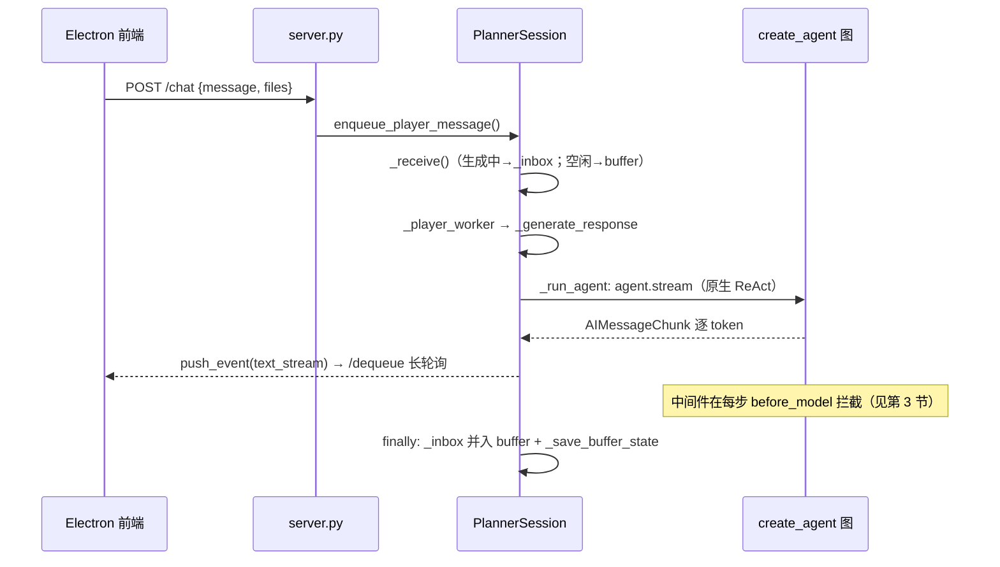
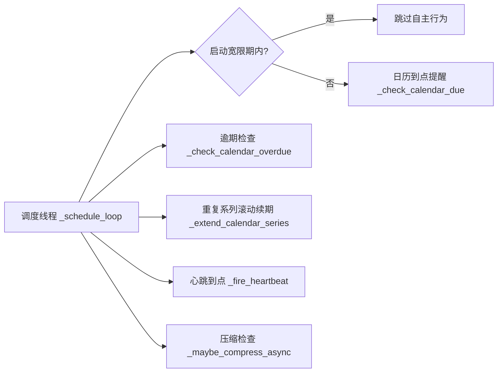
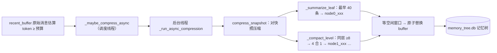

# planner 现状导览（tour）

> 目的：给想重新掌握项目的人一张完整地图——先知道有什么、各部件什么关系，再按顺序读代码。
> 配套：`README.md`（功能/运行/环境变量）、`AGENTS.md`（约定/发版/测试隔离）、`docs/api-contract.md`（前后端契约）。
> 维护约定：本文引用「文件 + 函数/类名」，不写死行号，防止代码演进后漂移。

当前版本：`v0.1.179`（2026-09-09）。测试 171 个（169 过；`test_server.py::test_tts_voices_endpoint`、`test_settings.py::test_tts_settings_applied_on_startup` 为 TTS 环境性失败）。
快照口径：本文按**开发工作区当前状态**描述（工作区含一批未提交的 tasks → calendar 重构，见第 5 节）。

---

## 0. 一分钟心智模型

- **它是什么**：Electron 悬浮球 + 本地 Python 后端 + DeepSeek 的桌面学习助手。不代替用户干活，负责：日历/提醒、长期记忆、陪伴式对话、语音交互。
- **两个进程**：
  - **Electron 主进程**（`frontend/main.js`）：悬浮球/面板窗口、托盘、**拉起并守护 Python 后端**、独占消费事件流后分发各窗口。
  - **Python 后端**（`src/planner/`）：HTTP JSON 服务（dev 18771 / release 18772），承载 agent、记忆、日历、语音。
- **数据全本地**（默认 `data/`；release 在 `planner-release/data`）：
  - `planner.db` — 日历（`store/calendar_db.py`）
  - `memory_tree.db` — 对话 buffer 持久化 + 分层记忆树（`memory/sqlite_memory_tree.py`）
  - `assistant/YYYY-MM-DD.jsonl` — 对话/工具日志
  - `tts/` — 合成音频缓存；`settings.json` — 用户设置
- **大脑**：DeepSeek（默认 `deepseek-flash`，DeepSeek-V4.1-Flash 多模态）+ LangChain `create_agent`（LangGraph 原生 ReAct：model → tools → model → …）

---

## 1. 代码地图

### 后端 `src/planner/`（约 8,000 行）

| 文件 | 规模 | 职责 |
|---|---|---|
| `session.py` | 2003 行 | **核心**：并发锁、消息收发、生成调度、心跳/日历调度线程、异步压缩、审批挂起、事件队列、状态 |
| `tools.py` | 1864 行 | 14 个基础工具（日历×4、心跳、分段说话、ask_user 提问、DND、记忆树、文件×2、截屏、**view_image 读图**、搜索×2）+ **代码工作区工具**（`get_cwd`、`apply_patch` 多文件补丁、读写/检索、`run_command`、`show_image`，仅 `workspace_root` 非空时注册） |
| `middleware.py` | 1217 行 | 11 个业务中间件（含 `ApprovalMiddleware` 审批、截屏/读图注入）+ 记忆树压缩实现（`SummarizationMiddleware`） |
| `server.py` | 904 行 | ThreadingHTTPServer + JSON 端点（`/workspace` `/approval` `/permissions` `/changes` `/llm` `/file` 等）+ 启动自检（端口清理） |
| `workspace.py` | 299 行 | 代码工作区：路径校验 / 黑名单 / 命令黑名单 / 权限规则存储（`data/permissions.json`） |
| `changes.py` | 222 行 | 变更留底/回退（`data/changes.db`：写操作前后快照、回退到某条之前、before→after diff 文本） |
| `llm_stats.py` | 98 行 | 用量/缓存命中统计（`data/llm_stats.json` 环形 50 条：命中率、TPS、平均 token） |
| `memory/sqlite_memory_tree.py` | 493 行 | 分层摘要树：add_leaf / compact / 查询 / buffer_state 持久化 |
| `tts.py` / `asr.py` / `ocr.py` | 453 / 208 / 132 行 | 本地语音合成（Kokoro）/ 识别（SenseVoice）/ OCR（RapidOCR） |
| `store/calendar_db.py` | 363 行 | 日历库（SQLite，WAL） |
| `llm.py` / `agent.py` | 461 / 81 行 | 模型构建（mock/真实、多服务商预设、视觉判定、reasoning/usage shim）/ create_agent 装配（含单轮调用上限） |
| `config.py` / `settings.py` | 95 / 168 行 | 环境变量 / 运行时用户设置 |
| `imageutil.py` / `content.py` | 77 / 32 行 | 图片→data URL / 内容块（含图片）→纯文本 |

### 前端 `frontend/`（约 6,600 行）

| 文件 | 规模 | 职责 |
|---|---|---|
| `main.js` | 1391 行 | 主进程：后端生命周期、窗口/托盘、`/dequeue` 唯一消费者、面板 resize、音频/图片落地代理、日志 |
| `renderer/app.js` | 2118 行 | 面板 UI：聊天区渲染、工具组/思考行（单行式）、审批与提问弹窗、图片气泡、状态条与统计面板、`@` 补全、变更 tab、心跳倒计时 |
| `renderer/voiceMode.js` | 526 行 | 语音对话模式：VAD 驱动录音、流式 TTS（预取/打断/括号过滤） |
| `renderer/bubble.js` + `morph.js` | 417 + 178 行 | 悬浮球交互（单击=放大 / 长按=语音输入 / 拖拽移动 / 拖文件挂载 / 右键菜单：放大、显示最近的气泡…）与窗口变形动画 |
| `renderer/mic.js` | 160 行 | 麦克风采集 + VAD（自适应噪声底噪） |
| `renderer/settings.js` | 438 行 | 设置窗口（TTS 引擎/音色、模型与服务商、压缩参数、代码工作区与授权规则） |

### 推荐先读顺序

`server.py`（有哪些出入口）→ `session.py`（一条消息怎么走）→ `agent.py`（75 行，中间件装配）→ `middleware.py`（每个类先读 docstring）→ 其余按需。

---

## 2. 三条主线

### 2a. 用户消息线（最重要）

关键点：
- `enqueue_player_message` 组装前缀（`[HH:MM]` + 距上次说话 + 文件挂载），`_receive` 根据是否正在生成决定进 `_inbox` 还是 buffer。
- `/dequeue?wait=25` 长轮询：`session.drain_events` 用 `threading.Condition` 挂起等待，有事件立即返回（`main.js::pollDequeue` 是唯一消费者）。
- 一轮生成内模型可连续调工具，直到「不再返回工具调用」才结束；`ModelCallLimitMiddleware(run_limit=10)` 只是硬保险。
- buffer 是唯一事实源：生成结束落盘（`_save_buffer_state`），重启时 `_load_buffer_state` 恢复。

### 2b. 自主线（调度线程）

- **心跳**＝「下一次何时醒来」的定时器，由模型通过 `heartbeat` 工具设置（clamp 1~720 分钟），模型没设时兜底 60 分钟。
- **免打扰**（默认 22:00-08:00）：`DndGuardMiddleware` 只拦自主触发；`player` / `nudge`（用户戳球）永远不限。
- **启动宽限**：打开后 2 分钟内不自主说话（`STARTUP_GRACE_SECONDS`）。
- **自主学习**：心跳生成中调用了搜索/阅读/记忆类工具 → 文字照常显示与入树，但**不朗读**，并用 30 分钟学习保底心跳续期。

### 2c. 记忆线（压缩与记忆树）

关键点：
- 阈值（`middleware.py`）：**叶子压缩只看 token 预算**——原始消息估算 token ≥ `compress_token_budget`（默认 10 万，
  估算 = 字符 × 1.2）触发；**保留最近 20 条**原文，批次 = `raw[:len(raw)-keep]`（连 keep 条都超预算时只保留最后 1 条）；
  节点**向上合并保持条数判定**：同层活跃节点 ≥ **8** → 取最早 **4** 个合并为父节点，递归向上。
  ⚠️ `memory/sqlite_memory_tree.py:21` 的 `LEAF_SIZE=20` 是**未被引用的遗留常量**，
  真正生效的是 `SUMMARIZE_KEEP_MESSAGES`，别当成两个阈值。
  四个值全部走 `settings`（`compress_token_budget`/`compress_keep`/`compact_threshold`/`compact_factor`），设置页可调。
- 压缩在**后台线程**完成（LLM 压缩需 10~30 秒，不阻塞回复）：调度线程只做阈值检查 →
  `threading.Thread` 跑 `compress_snapshot(snapshot)`（**只碰快照不碰真实 buffer**）→
  轮询等空闲窗口（`not _generating and not pending_response and not _inbox`）→
  毫秒级原子替换。替换**按消息 id 删**而非下标——压缩期间新到的消息位置全错位，
  id 不在删除集里自然保留；替换后调 `_strip_orphan_tool_messages()` 防御切段产生的孤儿 tool 消息。
- 节点消息带 `metadata.node_id` 常驻 buffer（可持久化、可被后续压缩合并）；`/history` 里作为 `role=memory` 显示在对话顶部；
  文本带层级与保护标记：`[node0_001 · L0 · 第a-b条] [已压缩 · 不需要压缩]`。
- 压缩输入边界：叶子 = **带标记的已有节点 + 待压原文**（保留的尾部不进输入）；
  节点压缩 = 目标节点去保护标记（从树渲染）+ 指令点名目标；不再把正文复制进指令。
- 输出为**任务型 schema v2**（`summary` + `task/decisions/lessons/context/user`，落 `meta.fields`）；
  旧画像节点走兼容渲染；`future_notes` 已移除。
- `explore_memory_tree` 工具让模型按需展开任意节点（`get_node_children_info` / `get_nodes_at_level`）；
  展开输出过大时落盘 `data/tool_results/`（读该目录免审批）。
- 叶子节点的 `details` 存**原始消息全文**（清洗掉 `image_url`，否则 base64 落盘纯浪费且会被当垃圾灌回上下文），
  摘要丢信息时可回溯原文。
- **量化效果**：LoCoMo 评测 138 条真实长对话，`llm_judge`（refined）= **0.688**，
  数据在 `research/locomo/outputs/`。谈"效果怎么量化"时用这个，别空谈。

---

## 3. 中间件链速查表（`agent.py::build_planner_agent` 按序装配）

| 中间件 | 钩子 | 职责 |
|---|---|---|
| `DndGuardMiddleware` | before_agent | 免打扰时段非玩家触发 → 跳 end |
| `AgendaSnapshotMiddleware` | before_agent | 议程指纹变化 → 注入 `[当前议程]`（今天+未来 7 天） |
| `PlayerPriorityMiddleware` | before_model | `_inbox` 有消息 → 跳 end（让位给用户） |
| `ScreenShotInjectMiddleware` | before_model | `_pending_screenshots` → 以 user 消息注入图片块 |
| `TypingHintMiddleware` | wrap_model_call | 用户正在打字 → 临时追加提醒（不落 state） |
| `StopRequestMiddleware` | before_model | `_stop_requested` → 跳 end（工具执行中不跳） |
| `NudgeMiddleware` | before + after_model | 第 5 轮注入「收尾提示」；`model_call_count` 计数 |
| `HeartbeatTrackMiddleware` | wrap_tool_call + before_model | 调过 heartbeat → 跳 end；ToolMessage 必须随 Command 带回 |
| `ApprovalMiddleware` | wrap_tool_call | 代码工作区审批：写/区外读挂起（超时拒绝），黑名单硬拒；拒绝时返回对齐 tool_call_id 的 ToolMessage |
| `LoggingMiddleware` | wrap_model_call / wrap_tool_call | 每轮 LLM/工具调用写 jsonl 日志（耗时一眼可见） |
| `SummarizationMiddleware` | before_model | **空壳**——压缩已异步化（`session._maybe_compress_async`） |
| `ModelCallLimitMiddleware` | 内建 | `run_limit=10` 硬保险（别改成 1，会被框架错误消息污染 buffer） |

**铁律**：所有「提前结束回合」的跳转必须在 **before_model**。create_agent 循环是 model → tools → model：在 after_model 跳会跳过刚返回的 tool_calls → 孤儿 `assistant(tool_calls)` → DeepSeek 400。同理，`HeartbeatTrackMiddleware` 返回 `Command` 时必须把工具结果放进 `update["messages"]`。

---

## 4. 关键不变量（改代码前必须知道）

- **锁**：`chat_lock`（同一时刻只有一条生成）＋ `buffer_lock`（保护 `recent_buffer`/`_inbox`/状态字段；RLock）。
- **`_inbox`**：生成期间用户消息的暂存区；`_generate_response` 的 finally 里消费（并入 buffer → `pending_response=True` → 下一轮生成）。
- **`_stop_requested`**：只对当前生成有效，每次生成开始重置；流消费循环里也会立即 break（半句不落 buffer）。
- **`current_trigger`**：`player` / `heartbeat` / `scheduled` / `nudge`——决定 DND 是否拦截、是否算自主学习。
- **模型解析链**（`llm.py::resolve_model_name`）：`settings.llm_model` > env `PLANNER_LLM_MODEL` > `deepseek-flash`。共享 `.env` 的 `LLM_MODEL` 是 xiaob 游戏的，**不影响 planner**。
- **视觉**：图片以 `image_url` 块随 user 消息**常驻 buffer**（每张 ≤384 token，每轮重发计费）；`/history` 与压缩摘要只取文本块。
- **数据隔离**：dev（18771 + 开发 `data/`）与 release（18772 + `planner-release/data`）互不触碰；测试一律 mock + `tmp_path`。
- **内部注入消息**：人类不可见的系统提示以 `（…）` 或 `[HH:MM]` / `[当前议程]` 开头，`/history` 会过滤，气泡/面板不显示。
- **启动自检**：`server.py::ensure_port_free` 读 `server.pid` + 验命令行含 "planner" 才清理残留进程（防误杀）；`app.log` 有 `[boot]` 横幅与在线/离线链路日志。

---

## 5. 时间线（"陌生感"的直接来源）

| 时间 | 变更 |
|---|---|
| 7 月 | **骨架级重构**：手写 ReAct 循环 → LangChain `create_agent` + 中间件链（移植自 yaya backend） |
| 8/16 | 语音大礼包：自适应噪声底噪、ASR 门控、流式 TTS 分组与预取、括号/emoji 过滤、打断卡死修复、自主学习心跳 |
| 8/21-22 | 视觉 + 诊断：默认 vision 模型、拖图原图直发、截屏注入（user 消息）、记忆树清洗 image_url、boot 日志/端口清理/voice_mode 持久化 |
| 9/9 | 说话规约：反 AI 味风格约束（`prompts/system.md`） |
| 近期（未提交） | **任务系统 → 日历单一入口重构**：`tasks_db.py` → `calendar_db.py`，工具改为 `list/add/update/cancel_schedule`；`get_next_actions`/`break_down_task` 概念废除（日历就是唯一待办） |
| 穿插 | 压缩从「before_model 同步」改为「调度线程 + 后台线程异步」 |

---

## 6. 术语表

| 词 | 含义 |
|---|---|
| buffer / `recent_buffer` | 当前上下文窗口（消息列表），持久化在 `memory_tree.db` 的 buffer_state |
| `_inbox` | 生成期间用户消息的暂存队列（生成结束才并入 buffer） |
| trigger | 生成触发类型：`player` / `heartbeat` / `scheduled` / `nudge` |
| heartbeat | 「下一次何时醒来」的定时器（1~720 分钟），**不是轮询** |
| nudge | 用户戳悬浮球 → 立即触发一次自主生成 |
| DND | 免打扰窗口（默认 22:00-08:00），只拦自主触发 |
| 自主学习 | 心跳生成中调用了 `web_search`/`read_file`/`explore_memory_tree` 等 → 不朗读 |
| node0 / node1 | 记忆树层级：level0 叶子（一次叶子压缩产物）/ level1 父节点（4 合 1） |
| `future_notes` | 压缩时借助「未来消息」对摘要/画像的事后校正字段 |
| 议程快照 | `[当前议程]` 注入（今天+未来 7 天，指纹去重） |
| `continue_speaking` | 分段说话工具：暂停片刻继续说下一点（可被用户打断） |
| 长轮询 | `/dequeue?wait=N`：无事件挂起至多 N 秒，有事件立即返回 |

---

## 7. 推荐阅读路线（对应分阶段带读）

1. **用户消息线**：`server.py` → `session.py`（`_receive` / `enqueue_player_message` / `_generate_response` / `_run_agent`）→ `agent.py` → `middleware.py`。
2. **机制专题**：
   - 2a 心跳与日历调度（`_schedule_loop` / `_fire_heartbeat` / `in_dnd` / 启动宽限）
   - 2b 压缩与记忆树（`_maybe_compress_async` / `_run_async_compression` / `SummarizationMiddleware`）
   - 2c 打断与停止（`_inbox` 让位 / `StopRequestMiddleware` / 流 break / `request_stop`）
3. **前端链路**：`main.js`（`ensureBackend` / `pollDequeue`）→ `preload.js` → `renderer/app.js` → `voiceMode.js` / `mic.js`。
